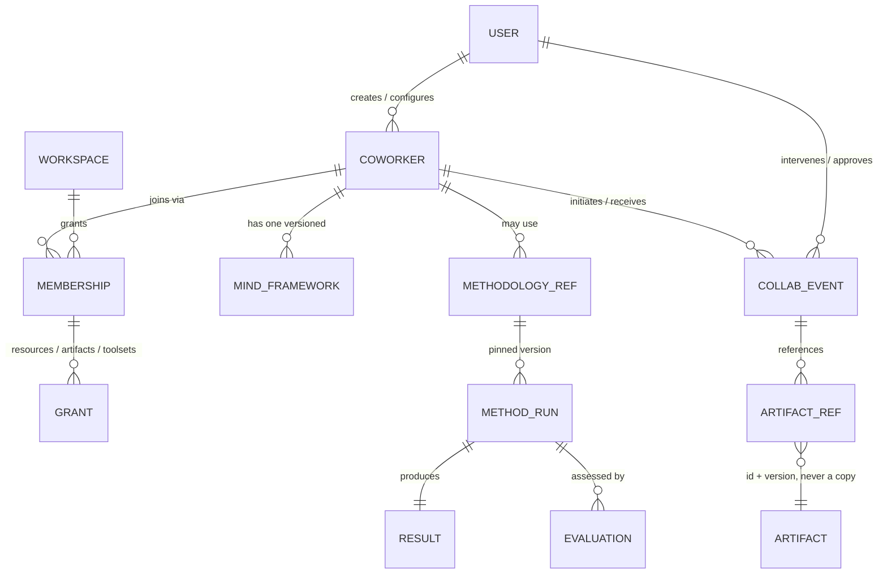
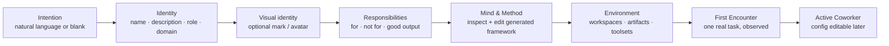
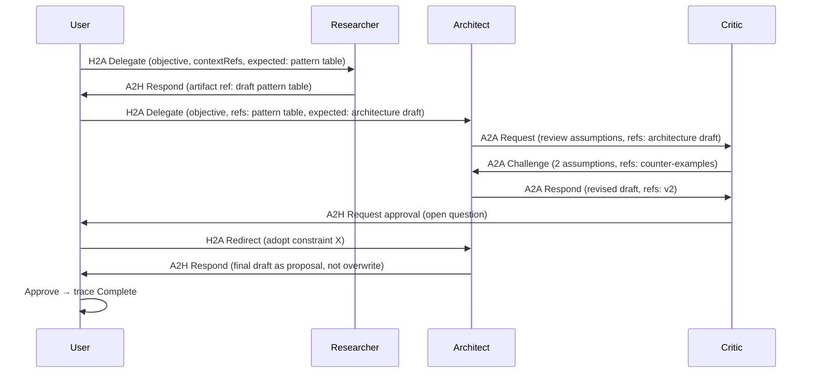

# Coworker — Product Vision & Initial Design Specification

**Date:** 2026-11-14 · **Status:** design specification. **No runtime implemented.**
**Source:** `THINKING.md` task brief (saved 11-14, execution deferred until go-ahead).
**Authority:** `docs/product/coworkers/` (D-054) stays in force. This document does not
amend it. Conflicts are listed in §10 and need a dated decision.
**Scope:** 8 deliverables — Vision · Domain Model · Creation UX · Mind Framework &
Methodology · Collaboration Model · Minimal Scenario · Local/Cloud Notes · Roadmap.

---

## 0. Labels used here

The brief requires one label per decision. Mapping to the repo's existing
`[C] / [P] / [I] / [Q]` convention (`docs/product/coworkers/README.md:7-10`):

| Label | Meaning | Equivalent |
| --- | --- | --- |
| **Confirmed** | Already decided in D-054 / product docs, or already in code | `[C]` / `[I]` |
| **Proposed** | This document's design proposal. Needs a human decision before building | `[P]` |
| **Open** | Cannot be answered from the repo; needs a person or external team | `[Q]` |
| **Deferred** | Deliberately not in this stage | `SCOPE.md §5` |

**Confirmed is not claimed for anything new in this file.** Every new design item is
Proposed or Open.

---

## 1. Phase 0 — repository audit (facts, not assumptions)

### 1.1 What exists in code

| Area | Fact | Evidence |
| --- | --- | --- |
| Coworker entity | `Coworker` type: id / name / description / status / createdAt / responsibilities(forWork,notFor,output) / memberships / pinnedArtifactIds | `src/data/coworkers.ts:7-30` |
| Seeds | 3 prototype records; file header says "Content is prototype data" | `src/data/coworkers.ts:1-5, 35-81` |
| Store | `thylas:coworkers:v1`, v1-validated read, cap 60, create / responsibilities / status / membership / delete / log | `src/state/coworkers.ts:12-13, 61-103, 131-262` |
| UI | 4 pages: Directory, Detail, New, Config; all `PlainLayout size="console"` | `src/pages/coworkers/` |
| Real interaction | Detail embeds the shipped `ChatCore`; Coworker enters as declared context | `CoworkerDetail.tsx:29-38, 95` |
| Honest placeholder | "nothing here is an agent runtime"; Toolsets = "grants are recorded, not enforced anywhere else"; Behaviour = "a control that changes nothing is not shipped" | `CoworkerDetail.tsx:91-94`、`CoworkerConfig.tsx:202-221` |
| Activity log | Real writes on create / responsibility edit / status / membership / delete | `src/state/coworkers.ts:171-256` |
| Avatar today | Initials + id-derived hue, not an image. `data-hue` + `.mark` | `CoworkerDirectory.tsx:20-33, 128-130`、`coworker.module.css:4-20` |
| E2E | 12 Coworker-named assertions | `scripts/ui-checks.mjs:2710-2855` |
| Theme | `src/lib/theme.ts` + 3 palettes; shipped after the product docs | `src/styles/themes.css:1-25` |

### 1.2 Backend and neighbouring domains

| Area | Fact | Evidence |
| --- | --- | --- |
| DB | 3 tables only: conversations / messages / files. **No Coworker table.** | `server/persistence/schema.ts:26-83` |
| Migrations | `0000`–`0002`; schema header marks workspaces/artifacts as later-phase | `schema.ts:6-16` |
| API | 9 path constants, all in `src/lib/*` contracts shared by server and client | `server/router.ts:48-67` |
| Auth | dev cookie `dev:<userId>:<wsIds>`, or fail-closed 401 when `CHORD_ISSUER` set | `server/session/source.ts:33-49` |
| Route order | session 401 → membership 403 → config/DB 503 → write | `server/routes/*.ts` headers |
| Chat contract | `Block` 4 variants (text/artifact/evidence/status), `Conversation`, `ContextSource` | `src/lib/chat.ts:16-54` |
| Model | `/api/ai` (non-stream) + `/api/ai/stream` (byte passthrough) + `/api/ai/status` | `server/ai-handler.ts:356-405` |
| Artifact | append-only versions `{v,at,by,note}`, external source, 7 kinds | `src/data/artifacts.ts:9-65`、`src/state/artifacts.ts:151-168` |
| User | `GET|PATCH /api/user`, dual mode `VITE_USER_SOURCE` | `server/routes/user.ts`、`src/state/user.ts` |

### 1.3 What does not exist

- **[Confirmed]** No agent runtime, no tool execution, no plugin system, no A2A code,
  no MCP client, no Coworker table, no avatar asset or generator. Runtime is named as
  absent in the shipped UI itself (`CoworkerDetail.tsx:93`).
- **[Confirmed]** Process runs are simulated client-side (`src/data/runs.ts:51-88`);
  compute seeds say "Nothing here executes, provisions or bills" (`src/data/compute.ts:18-19`).
- **[Confirmed]** `docs/product/coworkers/README.md:38-44` still says "No Coworker
  entity, store, or UI exists anywhere else" — **outdated**; §1.1 is the current fact.

### 1.4 Reusable, no duplication

| Reuse | From |
| --- | --- |
| Contract-in-`src/lib` pattern (wire change breaks both sides at compile time) | `src/lib/user.ts`, `ENGINEERING-STANDARDS.md §2` |
| Per-user server file store, 401 isolation | `server/user/store.ts` (D-059) |
| Validated envelope + activity log | `src/state/coworkers.ts`, `src/state/artifacts.ts` |
| Real conversation surface + declared context | `ChatCore`, `src/lib/chat.ts` |
| Artifact draft/proposal + attribution | `ARTIFACT-RELATIONSHIP.md §1` |
| List grammar, `PlainLayout`, `Field`, `EmptyState`, inline confirm | `src/components/ui.tsx`, `artifacts.module.css` |

---

## 2. Deliverable 1 — Coworker Vision

**Confirmed** — the definition in `docs/product/coworkers/DEFINITION.md:3-5` stands:
an independent, persistent AI work entity. Not a chatbot, not a system prompt, not a
conversation, not a WAM agent wrapper. "Users manage Coworkers; WAM runs them"
(`WAM-BOUNDARY.md:5-6`).

**Confirmed** — the product test is six outcomes (`DEFINITION.md §4`): same brief on new
material; only the granted things; visible current work and history; reusable outputs;
editable config over time; same entity in another workspace.

**Confirmed** — Thylas owns creation, identity, config, membership, access grants,
conversation, working interface, visualization. WAM owns agent execution, semantic
context, reasoning, tool execution, scheduling, model choice (`WAM-BOUNDARY.md §2`).

**Proposed** — one sentence for the long-term experience, consistent with the brief's
"commissioning" framing: *the user establishes a working relationship, and the record
of that relationship is the product*. Practical consequences:

| Consequence | What the user sees |
| --- | --- |
| A created Coworker has a visible standing brief | Config page reads like a brief, not a settings maze (`CONFIGURATION.md §8`) |
| Work is goal-ordered, not time-ordered | Current Work shows objectives + progress; conversation is one channel (`WORKING-EXPERIENCE.md §3`) |
| Every output is attributable and non-overwriting | Drafts/proposals with the Coworker's name; accepted artifacts keep their authority |
| Progressive development | Config editable any time, every change an activity entry, no autonomous self-modification |

**Open** — the brief's "Multi-Agent Must Be Functional" (Part I §3) contradicts
D-054 #7 and `WAM-BOUNDARY.md §3`. See §10 Q-A. **This document does not resolve it.**

---

## 3. Deliverable 2 — Coworker Domain Model

### 3.1 Entity relationship



### 3.2 Entities and shapes

**Confirmed** — the shipped `Coworker` shape is §1.1; the three status layers stay
separate: availability (Thylas), runtime execution (WAM), current-work state
(`LIFECYCLE.md §1`). Membership ≠ access; effective access = Coworker config ∩
workspace grants (`WORKSPACE-RELATIONSHIP.md §2`).

**Proposed** — minimal additions, kept as few objects as possible. No table per idea:

| Object | Minimal fields | Where it lives (proposal) |
| --- | --- | --- |
| Mind Framework | `version`, `principles[]`, `contextPolicy`, `uncertaintyPolicy`, `decisionRules[]`, `reflection`, `methodSelection` | One versioned config object on the Coworker. Not seven tables. |
| Methodology | `id`, `name`, `pinnedArtifactId`, `pinnedVersion`, `inputKind`, `outputKind` | A reference to an Artifact — not a new domain (`ARTIFACT-RELATIONSHIP.md §1` Apply verb) |
| Method Run | `id`, `coworkerId`, `methodologyRef`, `objective`, `contextRefs[]`, `status`, `startedAt`, `endedAt` | One record; feeds Current Work |
| Result | `runId`, `artifactRefs[]`, `summary`, `acceptedBy` | Artifact draft/proposal, attributed |
| Evaluation | `runId`, `criteria`, `verdict`, `by`, `at` | Append-only; feedback, never an edit to the method |
| Collab Event | §6.6 trace fields | Append-only trace; the smallest unit of collaboration |

**Proposed** — classification of Mind Framework elements (brief Phase 1 asks which is
which):

| Element | Static config | Runtime behaviour | Reusable component | Future |
| --- | --- | --- | --- | --- |
| Reasoning principles | ✓ | WAM interprets | as Artifact | — |
| Context organization | ✓ declared sources | WAM assembles | ✓ | — |
| Decision / uncertainty rules | ✓ | WAM applies | ✓ | — |
| Reflection / evaluation | ✓ criteria | WAM reports | ✓ | — |
| Methodology selection | ✓ eligible refs | WAM selects | ✓ | — |
| Autonomous self-modification | — | — | — | **Deferred**, explicitly excluded |

**Deferred** — model preference per Coworker (`SCOPE.md Q5`), cross-user sharing (Q7),
structured responsibility slots (Q8), Coworker-owned canonical artifacts
(`ARTIFACT-RELATIONSHIP.md §6`).

### 3.3 Access and permissions

**Confirmed** — context is declared, never ambient; nothing by default; grants per
membership in three categories; a Coworker sees nothing in a workspace it has not been
granted (`WORKSPACE-RELATIONSHIP.md §3`, `CONFIGURATION.md §4`).

**Proposed** — reuse Phase 1's order for any future server write: session 401 →
membership 403 → config → write. Coworker grants are **data Thylas owns**; WAM honours
them as bounds. Never pass a service token impersonating the user
(`docs/product/definition.md §9 B1`).

**Open** — who grants what (org roles), revocation semantics (`SCOPE.md Q2`).

---

## 4. Deliverable 3 — Coworker Creation Experience

### 4.1 Flow



Stages are conceptual, not mandatory separate pages (brief Phase 2).

### 4.2 Screen-by-screen outline

| Stage | User action | System response | Label |
| --- | --- | --- | --- |
| Intention | Types "a critical thinking partner for experiments", or picks Blank | Produces an editable Blueprint draft (name, brief, suggested methods). Every field visible and editable; nothing hidden in a prompt | **Proposed** |
| Identity | Edits name / description / role / domain | Validates required name + description; shows the mark | **Confirmed** (existing creation form: `CoworkerNew.tsx:60-137`) |
| Visual identity | Optional: keep the two-letter mark, or request a generated avatar | See §4.3 | **Open** (conflict) |
| Responsibilities | Edits three blocks | Saves to the standing brief; logged in activity | **Confirmed** (`CoworkerConfig.tsx:85-124`) |
| Mind & Method | Reviews generated framework + methodology list, edits or removes | Writes a versioned config object; shows "definition ≠ execution" honestly | **Proposed** |
| Environment | Adds a workspace, picks grants | Membership record with explicit grants; default = nothing | **Confirmed** (membership add/remove shipped) |
| First Encounter | Gives one small task | Runs through the existing real chat; shows what actually happened, with the trace visible | **Proposed**; see §9 |

**11-14 19:32:** the user asked to turn creation into a wizard. Implementation plan
(5 recommended steps, W-1…W-6, five open decisions):
[`CREATION-WIZARD.md`](CREATION-WIZARD.md). The table above stays the product-level
stage list; today's shipped flow is still the single form in `CoworkerNew.tsx`.

### 4.3 Visual identity — avatar generation (read `AVATAR-VISUAL-SYSTEM.md`)

**Confirmed** — today's mark is initials + id-derived hue; product docs say optional
visual identity, "a mark (colour + two letters) suffices for MVP; uploaded avatars
deferred" (`IDENTITY-RESPONSIBILITIES.md:9`, `SCOPE.md §2 #6`).

**Confirmed** — `docs/development/coworkers/AVATAR-VISUAL-SYSTEM.md` (v1.0, 11-14) is
a newer, more specific direction. Its contents:

| Part | Content | Lines |
| --- | --- | --- |
| Fixed, non-negotiable | solid black background; flat silhouette + thin line features; flowing wind-swept hair; face as solid/negative space; centered head-and-shoulders; vector-clean edges; no realistic lighting | `:36-49` |
| Customizable | primary color (`#D4A017` default), face shape, accessories, hair length, expression, gender presentation, optional secondary color | `:52-62` |
| Prompt enforcement | fixed positive anchor + aggressive negative prompt in every generation | `:70-82`, `:147-157` |
| System controls | lock background, style-adherent model / LoRA / IP-Adapter, reject failed contrast or photorealism | `:84-89` |
| Skill workflow | `thylas-coworker-avatar`: collect params → build prompt → generate → validate (retry ≤2) → square PNG 1024²/512² | `:104-145` |
| Validation checklist | black background, dominant hair, silhouette face, no photorealism, clean edges, correct primary color | `:168-175` |

**Open** — the 11-14 avatar system conflicts with the 11-12 `[P]` "uploaded avatars
deferred" and shifts visual identity from a generated mark to a generated portrait.
It is **not registered as a `[C]` decision** (`SCOPE.md §1` has no such ruling), and no
avatar code or skill file exists. Needs a dated decision before implementation: does
the avatar system replace `[P] #6`, or sit behind an explicit opt-in after MVP?

**Proposed** — if adopted, place it at the Identity stage as an optional step:
default = existing initials mark; "Generate portrait" runs the §6 workflow; the
validation checklist is a UI-visible gate, not a silent retry; the result is stored as
an asset reference on the Coworker record. No generation pipeline in this task.

### 4.4 Interaction and visual principles

- **Confirmed** — house grammar: `PlainLayout console`, artifacts list rows,
  `Field` / `Button` / `EmptyState`, inline confirm before consequential actions,
  one CSS module (`coworker.module.css:1-2`, `PLAN.md §4`).
- **Proposed** — deliberate but plain: a short "you are commissioning" sentence at
  the top; one primary action per screen; generated fields always visible and
  editable; advanced settings behind a disclosure, never forced; no fake progress.
- **Proposed** — First Encounter is one real task through the existing chat surface,
  followed by "what was recorded": the brief used, the context declared, and the
  trace. If the runtime cannot do it, the page says so. No simulated success.
- **Deferred** — multi-page wizard with tabs, animated "birth" sequences, template
  marketplace, avatar editing UI beyond the validation gate.

---

## 5. Deliverable 4 — Mind Framework & Methodology

### 5.1 Mind Framework is not a system prompt

**Confirmed** — identity ≠ prompt; responsibilities are structured, visible,
user-authored config (`D-054 #1-2`). Thylas records and displays; WAM reasons.

**Proposed** — a Mind Framework is one versioned object with 6 fields (§3.2). It is
**operationalizable**, not executable by Thylas: Thylas delivers it as a structured
brief; WAM decides how to instantiate it. A config change creates a new version and an
activity entry; no autonomous self-modification.

**Proposed** — observable difference test (brief Phase 3-D): give two Coworkers with
different `decisionRules` / `uncertaintyPolicy` the **same** task and **same** context;
compare the Method Run records — which methodology was selected, which evidence was
requested, when a human-input request was raised, and what the evaluation said.
Different prompts alone do not count. Until a runtime exists this test **cannot pass**;
record it as an acceptance criterion, not a current result.

### 5.2 Four nouns kept apart

| Noun | Meaning | Changes when |
| --- | --- | --- |
| Methodology | Reusable method definition, pinned to an Artifact version | User accepts a proposal to the method artifact |
| Method Run | One concrete execution of a pinned method | Started / completed / failed |
| Result | Structured output of that run (artifact refs, not copies) | Produced and attributed |
| Evaluation | Assessment of method application + result | Appended; never edits the method |

**Confirmed** — applying a methodology never mutates it; a run consumes a pinned
version; improvement goes into Evaluation as feedback (`ARTIFACT-RELATIONSHIP.md §2`,
`docs/product/artifacts/METHODOLOGY.md`).

**Proposed** — discovery/selection/reporting loop:
`eligible refs from grants → select by task kind → execute with declared context →
write Run + Result + Evaluation → surface in Current Work and Activity`.
Thylas owns the loop's **records**; WAM owns selection and execution. Until WAM exists,
only the records shape is designed.

**Deferred** — Thylas-side method executor, tool registry, spend limits, automatic
learning from reviewed work, forced mapping of every config field into Artifacts.

---

## 6. Deliverable 5 — Collaboration Model (A2A / A2H / H2A)

### 6.1 The three directions

| Direction | Meaning | Thylas surface | Owner |
| --- | --- | --- | --- |
| A2A | Coworker ↔ Coworker work coordination | Trace + transcript rendering **if delivered** | **WAM** (protocol, per D-054 #7) |
| A2H | Coworker → human: request input, surface a finding, ask approval | Current Work item, notification-free inline panel | Thylas renders; WAM initiates |
| H2A | Human → Coworker: delegate, redirect, challenge, approve, reject | Composer, inline controls on a work item | Thylas captures the decision; WAM acts |

**Confirmed** — "multiple Coworkers in one workspace are colleagues sharing a room,
not a multi-agent system"; no supervisor Coworker, no Thylas-side swarm planner
(`WAM-BOUNDARY.md §3`). **Open** — whether the brief's functional-collaboration
requirement changes this; see §10 Q-A.

### 6.2 Minimum useful primitive set

**Proposed** — for the first working scenario, 6 of the 9 listed primitives:

| Primitive | Needed | Why |
| --- | --- | --- |
| Request | ✓ | One Coworker asks another for a specific deliverable |
| Delegate | ✓ | Task + responsibility + expected output + context refs |
| Respond | ✓ | Structured output, not free-form chat |
| Challenge | ✓ | Question an assumption; forces a reply |
| Request Human Input / Approve / Reject | ✓ | Human intervention without a central coordinator |
| Complete | ✓ | Traceable closure |
| Negotiate | — | Deferred: two rounds of Request+Challenge cover the first scenario |
| Handoff | — | Deferred: a Delegation with context refs already transfers work |

### 6.3 Shared context, four layers

**Confirmed** — context is declared and visible, never ambient. **Proposed** — the
collaboration record keeps these separate:

| Layer | Content | Who may read |
| --- | --- | --- |
| Shared task context | objective, decision log, pinned artifact refs (id+version) | Participants of this task only |
| Coworker working context | its own Mind Framework version, private notes | That Coworker; user can inspect |
| Workspace resources | granted files / notes / boards | Bounded by membership grants |
| Artifact references | id + version + provenance | Bounded by grants; a reference is not a copy |
| Conversation history | existing chat envelope | Bounded by workspace |

No elaborate memory architecture, no vector DB, no unrestricted data access.

### 6.4 Traceability schema

**Proposed** — one append-only `CollabEvent` per interaction, with exactly the fields
the brief asks for:

```
id · taskId · seq · at · initiator · recipient · intent
request { objective, expectedOutput, contextRefs[] }
response { artifactRefs[], summary, status }
stateBefore · stateAfter · humanDecision { by, action, at } | null
```

Reconstruct a collaboration by filtering `taskId` and sorting `seq`. "Who proposed,
what was supplied, what was expected, what was produced, was it accepted, what
happened next" is answerable without trusting any agent's prose.

### 6.5 Human intervention

**Proposed** — the user can open any event, see request/context/expected/actual, then
redirect, challenge, approve, reject, or join the conversation directly. No central
coordinator required: H2A events address a specific Coworker. **Confirmed** — acceptance
of a consequential artifact stays with the artifact's authority
(`ARTIFACT-RELATIONSHIP.md §1`).

### 6.6 What would make it decorative

| Failure | Observable symptom |
| --- | --- |
| Three independent answers merged by a coordinator | No `CollabEvent` with a different recipient; no challenge/response pair |
| Prompt-only "different minds" | Same methodology selected, same evidence requested under different `decisionRules` |
| Free-text handoff | `contextRefs[]` empty; recipient re-asks for context |
| Fake progress | Current Work items with no linked Run or Result |
| Silent overwrite | An accepted artifact changes version without an accepted proposal |

---

## 7. Deliverable 6 — Minimal Working Scenario

**Proposed** — three Coworkers design an Agent Framework: Researcher (evidence +
patterns), Architect (structure), Critic (assumptions + weaknesses). Small enough for
a later MVP; **not implemented in this task**.



| # | Sender → Recipient | Intent | Payload | Expected response | State transition |
| --- | --- | --- | --- | --- | --- |
| 1 | U → R | Delegate | objective + contextRefs + expected `pattern table` | artifact ref | task: open → research running |
| 2 | R → U | Respond | draft Artifact ref, status draft | accept for next step | research done |
| 3 | U → A | Delegate | objective + refs(pattern table) + expected `architecture draft` | artifact ref | architecture running |
| 4 | A → C | Request | refs(draft v1) + "review assumptions" | challenge list | review running |
| 5 | C → A | Challenge | 2 assumptions + counter-example refs | revised draft | review → challenged |
| 6 | A → C | Respond | refs(draft v2) + answers | confirm or escalate | challenged → answered |
| 7 | C → U | Request Human Input | open question + both drafts | approve / redirect | waiting on human |
| 8 | U → A | Redirect | adopt constraint X | revised proposal | waiting → architecture running |
| 9 | A → U | Respond | final draft as **proposal** (never overwrite) | accept → new artifact version | running → review |
| 10 | U → trace | Complete | acceptedBy + artifactRefs | — | task: closed |

**Fails / becomes decorative** if any A2A row is replaced by a parallel independent
generation, any `contextRefs` is empty, the Critic never forces a reply, or the final
draft overwrites instead of proposing.

---

## 8. Deliverable 7 — Local Simulation & Cloud Compatibility

**Confirmed** — current local facts: `/api/ai` + `/api/ai/stream` against DeepSeek,
no WAM, client envelopes for Coworkers/Artifacts, per-user server files for User state
(D-059), no Coworker table.

**Proposed** — five separable layers so local work is not throwaway:

| Layer | Local now | Future cloud | Contract unchanged? |
| --- | --- | --- | --- |
| Domain logic | `src/lib/<domain>.ts` shapes + validators | same modules | ✓ |
| Application services | client store + `/api/ai` for real model calls | server routes + persistence | ✓ via shared contract |
| Runtime / model provider | `src/services/ai/*` → `/api/ai` | WAM agent runtime | ✓ request/response shape |
| Persistence adapter | `thylas:coworkers:v1`; per-user server file pattern | Postgres table + migration | ✓ DTO |
| External tool adapter | none; grants recorded only, never executed | WAM toolsets honouring grants | ✓ grant record |

**Proposed** — local simulation is limited to **deterministic trace fixtures**: a
scripted sequence of `CollabEvent`s with injected fetcher/LLM (the same technique as
`server/profile/pipeline.test.ts` and `src/state/chat.dual.test.ts`). It verifies the
trace schema, permissions, and UI rendering. It **must never be described as agents
collaborating** — that requires a runtime. The model endpoint may produce text; text
alone is not collaboration.

**Deferred** — queues, microservices, distributed infra, vector stores, event buses.
No concrete requirement exists in the repo.

**Open** — does one Coworker map to one persistent WAM agent or a per-session
instantiation? (`SCOPE.md Q1`, `WAM-BOUNDARY.md §4`) — Thylas UI stays agnostic.

---

## 9. Deliverable 8 — Implementation Roadmap

### 9.1 Priority order

| # | Work | Label | Depends on |
| --- | --- | --- | --- |
| 1 | Resolve §10 conflicts (A2A ownership, avatar direction, creation IA) | **Open** | Human decision |
| 2 | Coworker record → shared contract + server persistence (reuse D-059 file store / later a table) | **Proposed** | #1 |
| 3 | Config versioning on top of the existing activity log | **Proposed** | #2 |
| 4 | `CollabEvent` trace schema + deterministic fixture tests | **Proposed** | #1, #2 |
| 5 | First Encounter on the existing real chat surface | **Proposed** | #2, #4 |
| 6 | Methodology as pinned Artifact refs; Run/Result/Evaluation records | **Proposed** | #2, #4 |
| 7 | A2H / H2A inline controls on Current Work | **Proposed** | #4, #5 |
| 8 | A2A transcript rendering **when WAM delivers events** | **Deferred** | WAM contract |
| 9 | Mind Framework execution, toolsets, autonomous evolution | **Deferred** | WAM runtime |

### 9.2 Small, isolated part that could be built safely

**Implemented 11-14 (D-060), after the user's "开始执行" go-ahead.** Built exactly
the isolated scope: `src/lib/coworkers.ts` (contract + validators + six-row renderer),
an optional `mindFramework` field on `Coworker` with three distinct prototype
frameworks, validated read / default in `src/state/coworkers.ts`, and a read-only
section on `CoworkerConfig.tsx`. No runtime, no A2A, no table, no route.

**Q-D remains Open.** The shipped field is a **declared configuration record**, not
an executable mind. The config page says the runtime that would apply it is not
connected and that nothing there changes reasoning yet. No edit control was added,
so `CONFIGURATION.md §7` is not violated. Whether/when this becomes operationalizable
still needs a dated decision; §9.1 #3 (config versioning) stays blocked behind it.

**Verification:** `check` clean, 51 files / 433 tests green, targeted eslint clean,
8 new unit assertions plus one browser assertion. An isolated headless render check
(own Vite 5199 / CDP 9341) passed 9/9 assertions on the section: heading, six rows,
version, honest copy, zero controls, seed-specific content. The full e2e run stayed
blocked by a concurrent `ui-checks.mjs` instance holding ports 5180/8798.

### 9.3 Dependencies and blockers

| Blocker | Owner | Effect |
| --- | --- | --- |
| WAM contract (agent mapping, run attribution, state feed) | WAM team | Everything runtime-shaped; A2A; tool execution |
| Permission / org model | Product | Grant enforcement, cross-workspace reuse |
| Server-side Coworker persistence | D-052 sequencing | Records beyond one browser |
| CHORD IdP verifier | External | Real 401/403; dev cookie is a stand-in |
| Docker daemon | Local environment | Real Postgres migration still unverified |

### 9.4 Do not do in this stage

**Deferred** — WAM internals in Thylas, multi-agent orchestration, decorative
multi-agent UI, full creation wizard, avatar generation pipeline, tool execution,
vector memory, backend/frontend rewrite, new endpoints presented as existing.

---

## 10. Conflicts and Open decisions (need a human, not a default)

| # | Conflict | Sides | Needs |
| --- | --- | --- | --- |
| **Q-A** | Functional A2A vs D-054 #7 | Brief Part I §3 wants "multi-agent must be functional" with A2A work coordination. D-054 #7 / `WAM-BOUNDARY.md §3` say A2A is WAM's protocol, Thylas stores handles and renders delivered transcripts, no Thylas-side orchestration. | Decide: (a) keep [C], Thylas designs only the trace/rendering contract and the local scenario is a **fixture**, not live collaboration; or (b) amend [C] with a dated decision allowing a local deterministic coordinator. Option (b) changes the product boundary. |
| **Q-B** | Generated avatars vs `[P]` mark-only MVP | `AVATAR-VISUAL-SYSTEM.md` (11-14) requires a constrained generation pipeline. `IDENTITY-RESPONSIBILITIES.md:9` / `SCOPE.md §2 #6` say two-letter mark, uploaded avatars deferred. | Decide whether the 11-14 document supersedes `[P] #6`, and register it as `[C]` or keep it opt-in after MVP. |
| **Q-C** | Commissioning journey vs one-screen config | Brief Phase 2 wants 6 conceptual stages with natural-language blueprint generation. `CONFIGURATION.md §8` fixes one page, six sections, no tabs; the shipped `CoworkerNew.tsx` is a single form. | Decide whether the 6 stages are a **narrative** over the existing one screen, or a replacement IA. |
| **Q-D** | "Executable" Mind Framework / Methodology | Brief says a Methodology should be executable, not descriptive. Existing `[C]` gives reasoning/execution to WAM and keeps Thylas as record + declared config. | Decide what "operationalizable" means in Thylas before adding any field. A field that changes nothing must not ship. |
| **Q-E** | Coworker persistence | `SCOPE.md Q4` still open; D-059 chose per-user server files for **User** state only. | Choose table vs file for Coworker records when #2 starts. |

**11-14 19:32 update on Q-C:** the user asked for a plan to turn Coworker creation
into a wizard, so the IA direction is now given. Stage count, natural-language
Blueprint, avatar step and editable Mind Framework are still **Open**. Plan:
[`CREATION-WIZARD.md`](CREATION-WIZARD.md) (documentation only, no code started).
Q-A / Q-B / Q-D / Q-E are unchanged.

**Confirmed** — Q-A / Q-B / Q-D / Q-E remain unresolved; Q-C has a direction but no
settled stage design. `THINKING.md` requires "Do NOT silently convert proposals into
finalized architecture"; `AGENT.md §1.4/§8` requires preserving uncertainty.

---

## 11. Deliverable status

| # | Deliverable | Here | Status |
| --- | --- | --- | --- |
| 1 | Coworker Vision | §2 | Documented (Confirmed + Proposed) |
| 2 | Domain Model | §3, ER diagram | Documented (Proposed) |
| 3 | Creation UX | §4, flow diagram, avatar §4.3 | Documented (Proposed / Open) |
| 4 | Mind Framework & Methodology | §5 | Documented (Proposed) |
| 5 | Collaboration Model | §6 | Documented (Proposed, Q-A unresolved) |
| 6 | Minimal Scenario | §7, sequence diagram | Documented (Proposed, not implemented) |
| 7 | Local Simulation & Cloud Notes | §8 | Documented (Proposed) |
| 8 | Implementation Roadmap | §9 | Documented (Proposed, waiting approval) |

**Spec round (11-14 18:50):** documentation only.
**Implementation round (11-14 19:05, D-060):** the isolated §9.2 scope only —
`src/lib/coworkers.ts`, the optional `mindFramework` field + three prototype
frameworks, validated store read, a read-only config section, 8 unit assertions and
one browser assertion. No endpoint, no schema change, no avatar asset, no runtime,
no A2A. Q-D and the other four open conflicts are unchanged.
