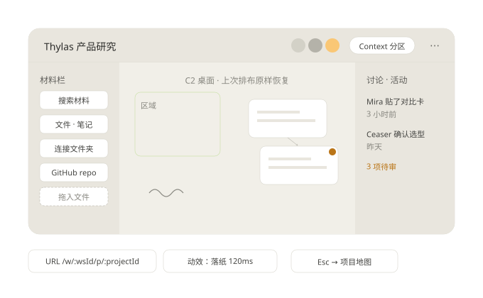
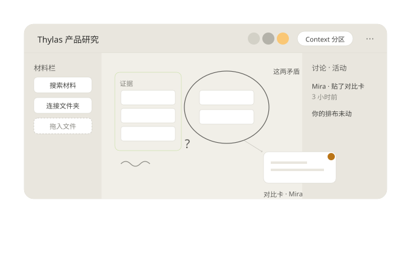
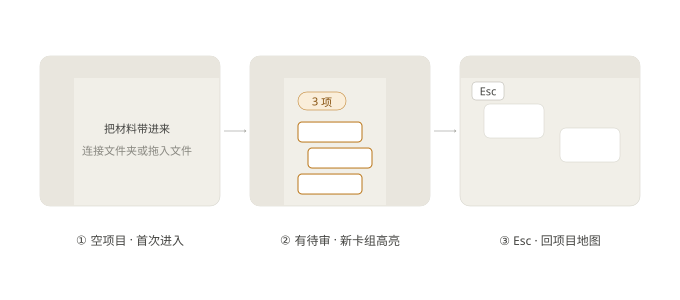

# Thylas Project 设计文档 · B 交互稿

> 草稿 B（Part IV 交互与界面 + Part V 执行计划）· 2026-11-23 · **待创始人评审**
> 评审关卡：①文字预算走查（见 13.2，逐条过）②配图定稿（figures/fig1–fig3 v1）。
> 标签约定同 A 稿。上游：03（设计方案）、05（执行计划）、空间环境愿景（C2）、A 稿（概念模型）。

---

# Part IV · 交互与界面

## 10. 导航 IA

### 10.1 场面

你打开 Thylas，Rail 顶部是切换器（环境层）。切到"CHORD"，Workspace 区显示项目地图——不是一抽屉文件夹和对话，是一排项目卡。

### 10.2 结构【提案】

```text
Rail
├─ Overview / Recently            ← Orient（聚合投影，不拥有内容）
├─ [Project 区 = 今天 Workspace 区的换代]
│   ├─ 切换器（环境层）
│   ├─ 项目地图（本 Workspace 内，列表先行）
│   └─ 项目卡 → 项目桌面
└─ Coworkers / Artifacts / Notes / Chat（Library 层，不变）
```

- **项目地图是组织层，不是必经之路**：Overview/Recently 聚合处点项目卡 → 直接进桌面。
- 项目对象可被 `@` 调用（接 `invoke.ts`）；URL `/w/:wsId/p/:projectId` 可回退可分享。

## 11. 项目桌面

### 11.1 点击行为【提案】

- **单击项目卡 = 进入项目桌面**（整屏 C2 空间）。三不：不弹窗、不做详情页、不做向导。
- 落纸 120ms 过渡（动效红线唯一允许的动作）。
- 落点：有待审产出 → 新卡组一次性高亮；否则恢复上次视口。
- Esc/返回 → 项目地图。

### 11.2 四区 layout（图 1）



| 区 | 内容 | 规则 |
|---|---|---|
| 顶栏 | 项目名 · 参与者头像 · Context 分区入口 · 菜单 | 名字 + ≤6 字状态词 |
| 材料栏 | 搜索 / 文件笔记 / 连接文件夹 / GitHub / 拖入 | "把材料带进来" |
| 桌面 | 材料卡 / 痕迹 / 区域 / 连接（C2 空间） | 上次排布逐像素恢复 |
| 讨论窄栏 | 活动 + 署名 + 待审计数 | 一行一事 ≤20 字 |

### 11.3 工作态（图 2）



场景 A 的现场：两堆卡、问号痕迹、圈注"这两矛盾"、Mira 的对比卡（琥珀角标）落在圈注旁——你的排布一个像素没动。

### 11.4 状态流（图 3）



①空项目：一行引导。②有待审：新卡组高亮 + 待审计数。③Esc：回地图。

## 12. 对话抽屉（随时调取的 agent chat）【提案 · 创始人修订①】

- **⌘J / 顶栏气泡**唤起右侧对话抽屉；收起后排布不动。
- = Home Conversation 的桌面常驻形态（"电话在旁边"的随时拿起）。
- 两个接口动作：圈选 → "带去对话"；对话结论 → "放回桌面"。
- 红线：不在桌面中央塞聊天窗；抽屉不遮挡圈选区域时可半屏。

## 13. 文字预算（防冗余硬规则）【提案 · 创始人修订②】

### 13.1 预算表

| 位置 | 预算 |
|---|---|
| 桌面卡 | 只有名字 + 角标，零描述段 |
| 痕迹/批注 | ≤ 12 字 |
| 窄栏活动 | 一行一事 ≤ 20 字："谁 · 做了什么 · 多久前" |
| 顶栏 | 名字 + ≤ 6 字状态词 |
| 空状态 | 一行 ≤ 20 字 |
| 按钮/菜单 | 动词 2–4 字 |
| 一切解释 | tooltip / 详情面板 / 文档 |

### 13.2 文案清单走查（B 阶段关卡）

| 文案 | 位置 | 字数 | 判定 |
|---|---|---|---|
| 把材料带进来 | 空状态/材料栏 | 6 | ✅ |
| 连接文件夹或拖入文件 | 空状态副行 | 10 | ✅（可并入上行则更短） |
| 搜索材料 / 文件 · 笔记 / 连接文件夹 / GitHub repo / 拖入文件 | 材料栏 | 4–6 | ✅ |
| Context 分区 | 顶栏 | 6+3 | ✅ |
| 3 项待审 | 窄栏 | 4 | ✅ |
| Mira 昨晚把你圈的两张读完了，在下面贴了一张对比卡 | 窄栏活动 | 23 | ❌ **砍** → "Mira · 贴了对比卡 · 3 小时前" |
| 点击这里开始创建您的项目 | （反例，禁止出现） | 11 | ❌ 形式禁止 → "+ 新建项目" |
| 路径失效，点击此处修复连接 | 错误态 | 12 | ❌ **砍** → "路径失效 · 修复" |
| 进入 / 共享 / 归档 / 转移 / 删除 | 右键菜单 | 各 2 | ✅ |
| 交给 Mira | 圈选胶囊 | 4+4 | ✅ |

**走查方法**：导出全部 UI 文案逐条过预算，超长即砍——上表即范例，实现期每加一条文案补一行。

## 14. 手势词汇（复用 C2 + 项目粒度新增）

| 手势 | 语义 | 松手时 |
|---|---|---|
| 拖卡 | 放置 | 直接落下 |
| 圈选 | 交代/聚焦 | 浮出胶囊："N 项被选中 · 交给 [Coworker]" |
| 卡拖线到卡 | 提出关系 | "连接为「回应」？" |
| 写/画 | 随手记 | 直接是痕迹 |
| 右键痕迹/便签 | 提升 | 保留 / 复制 / 删除 |
| 框区域 | 分组 | 区域线出现，可命名 |
| **单击项目卡（地图）** | 进入桌面 | 落纸 120ms |
| **hover 项目卡** | 浮层 | 摘要/最近一行/参与者 |
| **项目卡拖线** | 项目关系 | "这两个项目共用一个引擎？" |

设计红线不变：凡改变"你的东西是什么"的猜测，松手时一行字确认；放置和书写从不问。

---

# Part V · 执行计划

## 15. 里程碑

| 阶段 | 一句话 | 验证关卡 |
|---|---|---|
| P0 骨架 | Project 三表 + 引用连接器 | 连接→解析→改名→标失效→修复；卡存活（H1 检验） |
| P1 项目地图 | 列表先行 | 三 repo 成一张"Lemma"卡 |
| P2 项目桌面 | 四区 + 对话抽屉 + 文字预算 | 排布逐像素恢复；⌘J 三步内可对话；文案走查零超长 |
| P3 上下文 | 项目分区 + `@` + 跨项目引用 | 两项目共享一条 Context 且可解析 |
| P4 参与协作 | 参工层 + 署名落回 + 交接包 v0 | Mira 派进项目 → 产出带署名落回 |

## 16. 会师点与依赖

| 点 | 接法 |
|---|---|
| P2-3 对话抽屉 | = Home Conversation 桌面常驻态 |
| P3-2 `@` 调用 | 复用 `src/lib/invoke.ts` |
| P4-2 署名落回 | 复用 artifactCandidates / MutationIntent 治理 |
| P4-0 垫层 | Coworker 最小实体（id/头像/成员挂接），完整 Coworker 系统另立项 |

## 17. 风险与回退

| 风险 | 检验 | 回退 |
|---|---|---|
| H1 错（用户靠目录认项目） | P0 第一个关卡：改名后卡存活 | 项目退化为文件夹索引视图，砍对象模型 |
| 交接默认"复制+留痕"不合真实使用 | P4-3 试用 | 改权限转移（S1 另一案） |
| 双中心导航混乱 | P2 试用："进环境还是进项目"分不清 | 回退单中心 = Project |
| UI 文字长草 | 每加文案补 13.2 清单 | 文案走查不过不上线 |

---

## 本稿待拍板

1. **配图 v1（fig1–3）** 定稿否？有要改的区直接指。
2. **13.2 走查的 3 处"砍"** 认吗？
3. **对话抽屉半屏规则**（12）：可接受还是全屏右侧？
4. 手势表新增三行（11.4/14 项目粒度）有异议否？
