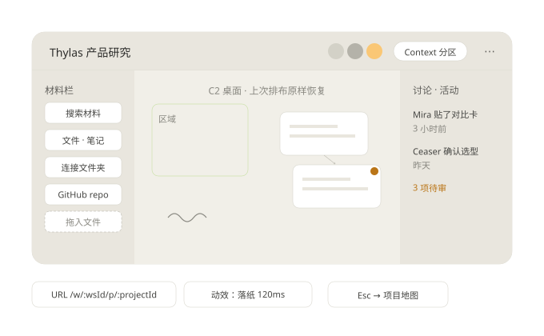
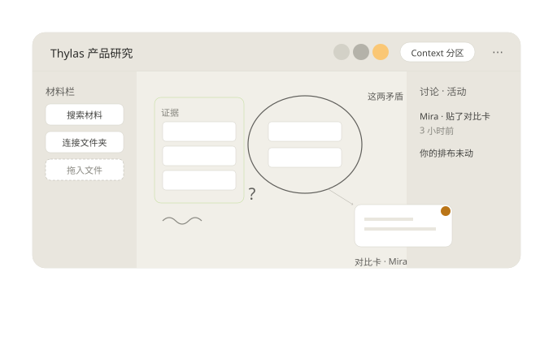
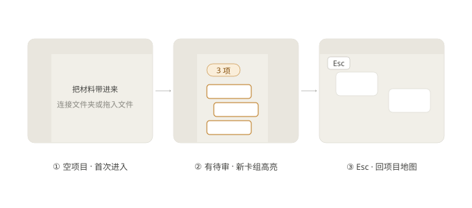

# Thylas Project 设计文档

## Project as a Collaborative Entity · v0.1

> 版本 v0.1 · 2026-11-23 · 成书稿（待独立可读性测试 + 页数确认 ≤24）
> 标签约定：【事实】仓库已存在 ·【直觉】创始人原话 ·【假设】未验证 ·【提案】本稿设计 ·【开放】未决。

### 一页纸导览

| Part | 回答什么 | 篇幅 |
|---|---|---|
| I 为什么是 Project | 工作今天散在哪；要换成什么 | ~3 页 |
| II 定位与概念模型 | Project / Workspace / Coworker 各是什么 | ~4 页 |
| III 用户场景 | 六个场景走查 + 未决 | ~4 页 |
| IV 交互与界面 | 点开项目卡之后的一切 | ~5 页 |
| V 执行计划 | P0–P4 怎么做出来 | ~3 页 |
| VI 开放问题 | 还没定的，全部在这 | ~2 页 |
| 附录 | Ream（暂存）/ 术语 / 文档索引 | ~2 页 |

---

# Part I · 为什么是 Project

## 1. 现状的问题

你手上的"Lemma"在哪？三个 repo 在磁盘三个角落，研究资料在文档里，和 Moelink 的讨论在聊天记录里，给 Mira 的交代在另一处。今天的软件给出的组织方式是"左边一抽屉文件夹和对话"——**文件按位置排，工作却不是按位置组织的**。

代价是每天都在付的：找回来靠记忆；交接靠口述；上下文每次重建。

【事实】今天的 Thylas 同样如此：Workspace 直接装 Files/Whiteboard/Processes，没有"项目"这一层（`src/shell/Rail.tsx`）。

## 2. 核心直觉

**从"文件在哪里"换成"工作在哪里"。**【直觉】

| 直觉 | 场面 |
|---|---|
| 身份先于资源 | 三个文件夹合成一张"Lemma"项目卡；磁盘不动，桌面只有一张卡 |
| 对象性向 Artifact 看齐 | 项目可命名、可 `@`、可讨论、可复用、有历史 |
| 空间是它的桌面 | 打开项目是一张桌子，不是列表抽屉 |
| Context 随项目走 | 项目有自己的分区；共享 = 引用，不是复制 |
| Coworker 是成员 | 有署名、参与历史、能交接工作现场 |
| 组织不预设层级 | 项目之上是环境（Workspace），不是必选的树根 |

## 3. 依据（引用不展开）

| 来源 | 给本稿什么 |
|---|---|
| GSC Manifesto | Context 六性质：持久/结构/寻址/可发现/可治理/可演化 |
| Artifact 对象性四论证 | lifetime / agency / reference / evolution——项目借这套机制 |
| MCS 研究 | 归因五类、View≠Representation、参与史先于版本史 |
| Ream 论文（全文已核，**暂存**） | 参与痕迹是双向界面；见附录 A |
| 空间环境愿景（C2） | 手势词汇与"不动你的排布"红线 |

---

# Part II · 定位与概念模型

## 4. Workspace ⊃ Project：双层定位

### 4.1 从一个场面开始

你说"把 `lemma-ai`、`LemmaKnowledgeBase`、`Analysis Engine` 三个文件夹做成 Lemma 项目"。
今天软件给你的回答是三个文件夹——或者三个工作区、三段对话。
你要的是**一张卡**：磁盘不动，桌面只有一张卡，点开就是干活的地方。

再看另一头：Mira 这个 Coworker 属于哪个环境、能用什么工具、被派进哪个项目——这些"人事和装备"的事，不该堆在任何一张项目卡里。它们属于项目**外面**的一层。

两件事，两层。

### 4.2 一句话模型【直觉】

**Workspace ⊃ Project。Workspace 是环境/机构层——装工具、装名册、管"谁进哪个 Project"；Project 是里面正在做的一件事。**

```text
Workspace（环境）
├─ 工具：Compute / Connect / …
├─ Coworker 名册与授权（入职管理）
├─ 人的成员、Workspace 级 Context / 设置
├─ Artifact 资产库（跨项目复用的家）
└─ Project × N（工作现场）
    ├─ 材料：文件 / 笔记 / 画布
    ├─ GSC 项目分区（Context）
    ├─ 讨论与活动（带署名）
    ├─ 参工的 Coworker（角色 / 子集授权 / 参与历史）
    └─ 产出 artifact
```

### 4.3 双层定位卡【提案】

| | **Workspace（环境）** | **Project（工作现场）** |
|---|---|---|
| 一句话 | 你建的一个工作机构：有名册、有装备、有规矩 | 机构里正在做的一件事：材料、上下文、产出、参与者 |
| 装什么 | Coworker 名册与授权、工具、Artifact 资产库、人的成员、Workspace 级 Context/设置 | 文件/笔记/画布（材料）、GSC 项目分区、讨论与活动、参工的 Coworker、产出 artifact |
| 不装什么 | 具体工作的材料与上下文 | 工具管理、名册、权限授予 |
| 界面 | Rail 顶部切换器 + 管理面 | 项目卡 → 项目桌面（C2 空间） |
| 生命周期 | 长期 | 有始有终（可归档） |

### 4.4 为什么不是别的形状【假设→已排除】

研究期排除了三种错误形态，记录在案防止回潮：

1. **Project 换代 Workspace**——被创始人推翻：Workspace 的工具与名册职责，Project 装不下。
2. **Project 是 Artifact 的一种 kind**——类别错误：Artifact 是工作**产出物**，Project 是产生产出物的**场所**。项目借 Artifact 的对象机制（id/引用/治理），不进 Artifact 分类。
3. **Project 只是文件夹的视图**——若成立（H1 假），对象模型整个做废。H1 的检验点在执行计划 P0：文件夹改名后项目卡必须存活。

## 5. Coworker 两层制

### 5.1 场面

你把 Mira 派进"Thylas 产品"项目，只授权 `docs/` 和 `research/`。
她写的决策卡落回桌面，署名"由 Mira 提出 · Ceaser 确认"。
她不在"Thylas 产品"里的产出，你看不到，也不该看到。

### 5.2 入职 vs 参工【提案】

| 层 | 动作 | 内容 |
|---|---|---|
| Workspace 级 = **入职** | 管理 Coworker 进入 | 名册、身份、工具权限 |
| Project 级 = **参工** | 派进项目 | 角色（在这做什么）、资源授权子集、参与历史、产出署名 |

**授权红线【事实，延续既有设计】**：Coworker 的有效授权 = 自身配置 ∩ Workspace 给予 ∩ Project 子集。三层取交集，永远不放宽。

### 5.3 署名最小闭环【提案】

- 第一版只做"显示名字"（谁提出/谁修改/谁确认），不做可验证身份（数字身份后议）。
- 署名挂对象与内容两层：卡级角标 + 决策条目行内署名。
- 署名 ≠ 归因 ≠ 溯源，三层分开：署名=谁以自己名义；归因=以什么意图；溯源=信息从哪来。第一版只做署名 + 溯源，归因词汇暂缓。

## 6. 对象模型

### 6.1 四件套【提案】

| 对象 | 字段最小集 | 责任 | 不负责 |
|---|---|---|---|
| **Project** | id、name、summary、workspace_id、state（active/archived/deleted）、时间 | 工作现场的身份与归属 | 不装资源内容 |
| **project_connections** | id、project_id、kind（local-folder / github-repo / file / note / artifact / gsc-context）、locator、状态 | 资源引用登记（**引用不复制**） | 不搬文件、不做文件系统 |
| **project_members** | project_id、actor（人/Coworker）、role、资源子集授权、参与历史 | 参工关系 | 不做入职（归 Workspace） |
| **Context 分区** | project 级 scope（GSC），条目级引用边 | 项目上下文的家 | 不复制被共享条目 |

### 6.2 引用不复制【事实，D4 既有原则的延伸】

`D:\github projects\GSC` 被"GSC 接口"和"Thylas 产品"两个项目引用——两边看到的是同一真实文件。
一致性天然成立；冲突（一方要独占修改）在体验层提示，仲裁在文件系统/Git【开放】。
路径改名/移动 → 连接器标"待修复"，项目卡（id）不受影响。

### 6.3 生命周期【提案】

- 项目：active → archived（卡片进归档视图）→ deleted（软删 30 天）。
- **Context 分区与项目生命周期解耦**：项目归档后分区保留，被引用条目仍可解析，参与历史与署名保留。
- 转移（换 Workspace）需授权闭合检查（名册/工具授权对齐）【开放】。

## 7. 系统边界与命名裁定

### 7.1 责任表【提案，基于既有边界】

| 归属 | 负责 | 不负责 |
|---|---|---|
| **Thylas** | Project 的创建/组织/呈现；资源连接与引用登记；Coworker 参工体验；讨论/活动/交接体验；空间化呈现 | 信息对象的持久化治理（归 GSC）；Agent 运行时（归 WAM） |
| **GSC** | Context/信息对象的持久、结构、寻址、治理、演化；溯源；访问控制与共享机制；项目级 scope | 工作流程编排；协作 UI |
| **CoworkOS（未来）** | Coworker 间协作协议（交接/署名/委派动词） | Agent 运行时（WAM 边界不变） |
| **WAM** | Agent 运行时（计划/执行/调度） | —— |

一条红线：**CoworkOS 是协作协议，不是运行时**；交接的体验在 Thylas，动词在协议层。

### 7.2 命名裁定【提案】

| 词 | 裁定 |
|---|---|
| Cluster | 砍掉——职责并入 Workspace（未来若出现"跨 Workspace 项目群"需求再议） |
| Workspace | 保留，含义收窄为"环境/机构层" |
| Project | 新对象：工作现场层，属于唯一 Workspace【开放】 |
| 署名 / 归因 / 溯源 | 三层分开，见 5.3 |

---

# Part III · 用户场景

## 8. 六个场景

> 每场景三行：**看到什么 / 做什么 / 系统发生什么**。完整 10 场景见研究稿 02。

### 8.1 连接本地文件夹

- **看到**：Workspace 的项目地图；"+ 新建项目"；材料栏"连接文件夹"。
- **做**：建项目卡"Thylas 产品研究"，连接 `D:\github projects\Thylas`。
- **系统**：Project 获得 id/名字/Context 分区；文件夹只登记引用，文件不动；改名 → 连接器标"待修复"，卡存活（H1 检验）。

### 8.2 三个 Repository 组成一个项目

- **看到**：项目"Lemma"的桌面，材料栏"连接 GitHub"。
- **做**：把 `lemma-ai`、`LemmaKnowledgeBase`、`Analysis Engine` 连进项目，摆卡。
- **系统**：三份引用挂同一 Project；repo 是资源不是项目；Coworker 参工后按授权看到引用。

### 8.3 两个项目共享 Context

- **看到**：项目 A 分区里决策"检索管线选型"；项目 B 分区里"引用自 A"卡。
- **做**：在 B 里 `@A 的选型决策`。
- **系统**：GSC 记条目级引用边，不复制；A 更新 → B 引用处标"已更新"；B 的参工者只可读被共享条目。

### 8.4 Coworker 加入项目

- **看到**：Workspace 管理面"名册：Mira（研究员）"；项目卡"参与者"区。
- **做**：把 Mira 派进"Thylas 产品"，给角色"研究助理"，勾资源授权子集。
- **系统**：入职/参工两层分离；Mira 只见授权材料 + 项目分区；产出落回桌面新卡组（不覆盖你的排布），署名 Mira。

### 8.5 Coworker 之间交接

- **看到**：Mira 工作卡组旁"交接"动作；交接包预览（当前理解/已做/未决/建议下一步）。
- **做**：Mira 把包交给 Archer，你附一句指令。
- **系统**：工作状态包（working context 引用 + 痕迹 + 授权范围）转移；留交接记录（双方署名）；Archer 打开是完整工作现场，不是聊天记录。【开放 S1：转移 vs 复制，默认复制+留痕】

### 8.6 项目归档

- **看到**：项目卡菜单"归档/转移/删除"。
- **做**：归档"Thylas v0 调研"。
- **系统**：卡进归档视图；Context 分区保留、被引用条目可解析、参与历史与署名保留；删除 = 软删 30 天。

## 9. 场景暴露的未决

| # | 未决 | 现行默认 |
|---|---|---|
| S1 | 交接 = 权限转移还是复制 | 复制 + 留痕（安全侧） |
| S2 | 复用语义：引用/派生/模板/fork | 引用 + 派生先行，模板后置 |
| S3 | 文件夹改名后连接器失效与重建体验 | 标"待修复"，手动重建 |
| S4 | 跨 Workspace 共享的授权闭合 | 名册 × 分区 × 工具三项对齐后放行 |
| S5 | 共享粒度（整分区 vs 条目） | 条目级 |
| S6 | 独占修改冲突的提示层 | Thylas 提示，文件系统/Git 仲裁 |

---

# Part IV · 交互与界面

> 导语：打开 Thylas，不再是一抽屉文件夹和对话，而是一张项目地图：每个项目一张卡，点一下，落纸进入它的桌面。桌面记得你摆过的一切——两堆卡、圈注、问号痕迹，原样在那里。早上回来，昨晚的排布原样恢复，右栏一行小字：Mira 昨晚贴了对比卡。左边一栏只说一句话：把材料带进来。连上本地文件夹或 GitHub 仓库，磁盘不动，卡就是项目本身；文件夹改名了，卡还在，只标一行"路径失效"。
>
> 想让 Mira 干活，圈出那堆卡，一句话就是工单。她的结果落在旁边的新卡组里，带着她的名字，你的排布一个像素不动。待审的产出在角落标一个数，点开就采纳或驳回。想说话，⌘J 拉出对话抽屉，说完收起，桌面不乱。Mira 下班，把"当前理解+已做+未决"打包交给 Archer——Archer 打开的是一张完整工作现场，不是聊天记录。屏幕上几乎没有长句：卡上只有名字，活动流一行一事，按钮都是两三个字的动词。
>
> 做完的项目归档，它的上下文还活着，还能被别人引用。整个体验一句话：你只管摆、圈、说，系统记住一切，打扰降到零。

## 10. 导航 IA

### 10.1 场面

你打开 Thylas，Rail 顶部是切换器（环境层）。切到"CHORD"，Workspace 区显示项目地图——不是一抽屉文件夹和对话，是一排项目卡。

### 10.2 结构【提案】

```text
Rail
├─ Overview / Recently            ← Orient（聚合投影，不拥有内容）
├─ [Project 区 = 今天 Workspace 区的换代]
│   ├─ 切换器（环境层）
│   ├─ 项目地图（本 Workspace 内，列表先行）
│   └─ 项目卡 → 项目桌面
└─ Coworkers / Artifacts / Notes / Chat（Library 层，不变）
```

- **项目地图是组织层，不是必经之路**：Overview/Recently 聚合处点项目卡 → 直接进桌面。
- 项目对象可被 `@` 调用（接 `invoke.ts`）；URL `/w/:wsId/p/:projectId` 可回退可分享。

## 11. 项目桌面

### 11.1 点击行为【提案】

- **单击项目卡 = 进入项目桌面**（整屏 C2 空间）。三不：不弹窗、不做详情页、不做向导。
- 落纸 120ms 过渡（动效红线唯一允许的动作）。
- 落点：有待审产出 → 新卡组一次性高亮；否则恢复上次视口。
- Esc/返回 → 项目地图。

### 11.2 四区 layout（图 1）



| 区 | 内容 | 规则 |
|---|---|---|
| 顶栏 | 项目名 · 参与者头像 · Context 分区入口 · 菜单 | 名字 + ≤6 字状态词 |
| 材料栏 | 搜索 / 文件笔记 / 连接文件夹 / GitHub / 拖入 | "把材料带进来" |
| 桌面 | 材料卡 / 痕迹 / 区域 / 连接（C2 空间） | 上次排布逐像素恢复 |
| 讨论窄栏 | 活动 + 署名 + 待审计数 | 一行一事 ≤20 字 |

### 11.3 工作态（图 2）



场景 A 的现场：两堆卡、问号痕迹、圈注"这两矛盾"、Mira 的对比卡（琥珀角标）落在圈注旁——你的排布一个像素没动。

### 11.4 状态流（图 3）



①空项目：一行引导。②有待审：新卡组高亮 + 待审计数。③Esc：回地图。

## 12. 对话抽屉（随时调取的 agent chat）【提案】

- **⌘J / 顶栏气泡**唤起右侧对话抽屉；收起后排布不动。
- = Home Conversation 的桌面常驻形态（"电话在旁边"的随时拿起）。
- 两个接口动作：圈选 → "带去对话"；对话结论 → "放回桌面"。
- 红线：不在桌面中央塞聊天窗；抽屉不遮挡圈选区域时可半屏。
- 输入法安全：中文组字中 Enter 不发送（`isComposing` 判定）；⌘J 唤起后焦点落在输入框，Esc 收起焦点回桌面。

## 13. 文字预算（防冗余硬规则）【提案】

### 13.1 预算表

| 位置 | 预算 |
|---|---|
| 桌面卡 | 只有名字 + 角标，零描述段 |
| 痕迹/批注 | ≤ 12 字 |
| 窄栏活动 | 一行一事 ≤ 20 字："谁 · 做了什么 · 多久前" |
| 顶栏 | 名字 + ≤ 6 字状态词 |
| 空状态 | 一行 ≤ 20 字 |
| 按钮/菜单 | 动词 2–4 字 |
| 一切解释 | tooltip / 详情面板 / 文档 |

### 13.2 文案清单走查

| 文案 | 位置 | 判定 |
|---|---|---|
| 把材料带进来 | 空状态/材料栏 | ✅ |
| 连接文件夹或拖入文件 | 空状态副行 | ✅ |
| 搜索材料 / 文件 · 笔记 / 连接文件夹 / GitHub repo / 拖入文件 | 材料栏 | ✅ |
| Context 分区 | 顶栏 | ✅ |
| 3 项待审 | 窄栏 | ✅ |
| Mira 昨晚把你圈的两张读完了，在下面贴了一张对比卡 | 窄栏活动 | ❌ 砍 → "Mira · 贴了对比卡 · 3 小时前" |
| 点击这里开始创建您的项目 | 反例 | ❌ 禁止 → "+ 新建项目" |
| 路径失效，点击此处修复连接 | 错误态 | ❌ 砍 → "路径失效 · 修复" |
| 进入 / 共享 / 归档 / 转移 / 删除 | 右键菜单 | ✅ |
| 交给 Mira | 圈选胶囊 | ✅ |

**走查方法**：导出全部 UI 文案逐条过预算，超长即砍——实现期每加一条文案补一行。

### 13.3 韧性文本与紧凑 UI【提案，UI-UX-Pro-Max 指导并入】

1. 标题平衡换行只是渐进增强——设计必须在自然换行下成立。
2. 必要文本在窄宽/浏览器缩放/用户间距覆盖下不得裁切；长 URL/locator 可安全换行。
3. 芯片组换行或 `+n` 展开；截断必须给键盘/指针/触摸同等的完整值路径（顶栏参与者头像、圈选胶囊）。
4. **徽章含义不能只靠颜色**：琥珀角标配形状或文字；计数带语境（"3 项待审"，不是"3"）。
5. 快速连击可取消动画，但最终语义状态/焦点/内容必须正确——落纸中再点另一张卡，最终停在后者。

### 13.4 交付检查表（Thylas 版，P2 硬关卡）

| 检查项 | 标准 |
|---|---|
| 图标 | 全 SVG，禁 emoji |
| 指针 | 可点元素全部 cursor-pointer |
| 动效 | 落纸 120ms；`prefers-reduced-motion` 下直接落位 |
| 对比度 | 纸底上正文与弱文字 ≥ 4.5:1 |
| 焦点 | 键盘焦点环全部可见（keyboard-first） |
| 重排 | 文本/芯片/徽章不裁切，截断有完整值出口 |
| 布局 | 1024/1440 两档；窄窗降级列表视图 |
| 表单 | 修错即清、保留输入、未保存提醒、可撤销 |
| IME | 组字中 Enter 不发送 |

（完整映射与冲突裁定见研究稿 07。）

## 14. 手势词汇（复用 C2 + 项目粒度新增）

| 手势 | 语义 | 松手时 |
|---|---|---|
| 拖卡 | 放置 | 直接落下 |
| 圈选 | 交代/聚焦 | 浮出胶囊："N 项被选中 · 交给 [Coworker]" |
| 卡拖线到卡 | 提出关系 | "连接为「回应」？" |
| 写/画 | 随手记 | 直接是痕迹 |
| 右键痕迹/便签 | 提升 | 保留 / 复制 / 删除 |
| 框区域 | 分组 | 区域线出现，可命名 |
| 单击项目卡（地图） | 进入桌面 | 落纸 120ms |
| hover 项目卡 | 浮层 | 摘要/最近一行/参与者 |
| 项目卡拖线 | 项目关系 | "这两个项目共用一个引擎？" |

设计红线不变：凡改变"你的东西是什么"的猜测，松手时一行字确认；放置和书写从不问。

---

# Part V · 执行计划

## 15. 里程碑

| 阶段 | 一句话 | 验证关卡 |
|---|---|---|
| P0 骨架 | Project 三表 + 引用连接器 | 连接→解析→改名→标失效→修复；卡存活（H1 检验） |
| P1 项目地图 | 列表先行 | 三 repo 成一张"Lemma"卡 |
| P2 项目桌面 | 四区 + 对话抽屉 + 文字预算 | 排布逐像素恢复；⌘J 三步内可对话；文案走查零超长；**13.4 检查表全过** |
| P3 上下文 | 项目分区 + `@` + 跨项目引用 | 两项目共享一条 Context 且可解析 |
| P4 参与协作 | 参工层 + 署名落回 + 交接包 v0 | Mira 派进项目 → 产出带署名落回 |

## 16. 会师点与依赖

| 点 | 接法 |
|---|---|
| P2-3 对话抽屉 | = Home Conversation 桌面常驻态 |
| P3-2 `@` 调用 | 复用 `src/lib/invoke.ts` |
| P4-2 署名落回 | 复用 artifactCandidates / MutationIntent 治理 |
| P4-0 垫层 | Coworker 最小实体（id/头像/成员挂接），完整 Coworker 系统另立项 |

## 17. 风险与回退

| 风险 | 检验 | 回退 |
|---|---|---|
| H1 错（用户靠目录认项目） | P0 第一个关卡：改名后卡存活 | 项目退化为文件夹索引视图，砍对象模型 |
| 交接默认"复制+留痕"不合真实使用 | P4-3 试用 | 改权限转移 |
| 双中心导航混乱 | P2 试用："进环境还是进项目"分不清 | 回退单中心 = Project |
| UI 文字长草 | 每加文案补 13.2 清单 | 文案走查不过不上线 |

---

# Part VI · 开放问题与假设

## 18. 未决汇总

### 18.1 六条默认（待拍板）

| # | 问题 | 默认 |
|---|---|---|
| 1 | 今天 Workspace 里的 Files/Boards/Processes/Notes 迁入 Project？ | 迁，允许"未归类"暂存 |
| 2 | Artifact 资产库放 Workspace 级、项目只引用？ | 是 |
| 3 | Context 三层：personal / workspace / project，共享=引用？ | 是 |
| 4 | 项目画布 per-Workspace，Overview 聚合投影？ | 是 |
| 5 | Cluster 砍掉？ | 砍 |
| 6 | 项目属于唯一 Workspace？ | 是 |

### 18.2 产品假设（验证中）

| # | 假设 | 若假 |
|---|---|---|
| H1 | 项目身份的锚是意图，不是位置 | 项目退化为文件夹索引视图 |
| H2 | 项目边界是 Context 边界，不是文件边界 | scope/署名降级，画布优先 |
| H3 | 复用的单位是项目整套工作现场 | Artifact 级复用已够 |
| H4 | Coworker 长期参与价值 > 一次性委派 | 参工层是过度设计 |
| H5 | 空间化是工作方式，不只是展示 | Canvas 退回展示层 |

### 18.3 场景未决（S1–S6）

见 §9 表。

---

# 附录

## A. Ream 应用脑暴（暂存）

Ream 论文（arXiv 2610.09497，全文已核）的参与痕迹机制启发了本稿的署名与活动流设计：痕迹是双向界面——人读它管 agent，agent 读它接续工作。取 8 补 5 增 5 的完整脑暴见研究稿 04。**创始人指示暂存**：待项目骨架/桌面成型后再回来（参与条三级可视化、Agent 探索区、交接信号包等）。

## B. 术语表

| 词 | 定义 |
|---|---|
| Project | 工作现场层的对象：材料、上下文、产出、参与者的家 |
| Workspace | 环境/机构层：工具、名册、授权 |
| 入职 | Coworker 进入 Workspace（名册/身份/工具权限） |
| 参工 | Coworker 被派进 Project（角色/子集授权/署名） |
| 引用 | 资源挂接方式，不复制内容（连接器登记） |
| 派生 | 以他项为源做出新项，记 `derived_from` 边 |
| Context 分区 | 项目级 GSC scope，项目上下文的家 |
| 署名 | 谁以自己名义说了/做了（≠归因≠溯源） |
| 交代 | 圈选 + 一句话 = 交给 Coworker 的工单 |
| 交接 | 进行中工作状态的转移（working context + 痕迹 + 授权） |
| 项目地图 | Workspace 内的项目组织层（列表先行，画布后补） |
| 项目桌面 | 点开项目卡进入的 C2 空间 |
| 对话抽屉 | ⌘J 随时调取的 agent chat（Home Conversation 常驻态） |
| 落纸 | 唯一允许的动效（120ms） |

## C. 研究文档索引

| 文档 | 内容 |
|---|---|
| `01-positioning-workspace-project.md` | 定位校准：Workspace ⊃ Project |
| `02-scenarios.md` | 10 场景推演 + S1–S6 |
| `03-design-proposal.md` | 设计方案（三段格式） |
| `04-ream-application.md` | Ream 脑暴（暂存） |
| `05-execution-plan.md` | 执行计划 P0–P4 |
| `06-design-doc-outline.md` | 本 PDF 的 Outline 与写作阶段 |
| `07-ui-ux-guidelines.md` | UI-UX-Pro-Max 指导并入（检查表/韧性文本/IME/冲突裁定） |
| `draft/A-core.md` / `B-interaction.md` | 本稿的分部草稿（含评审清单） |
